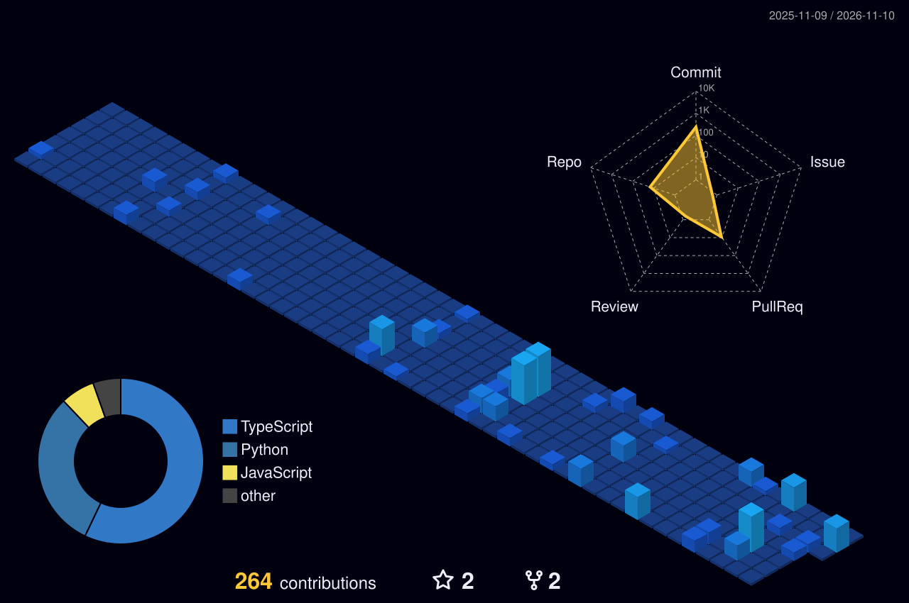

# 💜 MANYA VALECHA | PURPLEVERSE

  

<h1 align="center">Hey there, I'm Manya! 👋</h1>

  

  <b>AI/ML ENGINEERING · FULL-STACK DEVELOPMENT · APPLIED RESEARCH</b>

  
  
  

  

  

## ✨ ABOUT ME

I'm **Manya Valecha**, a final-year Information Technology undergraduate at **Delhi Technological University (DTU), India**.

I enjoy turning ambitious ideas into meaningful technology. My interests lie at the intersection of Artificial Intelligence, Machine Learning, Full-Stack Engineering and human-centred innovation.

- 🎓 B.Tech Information Technology @ DTU (2023–2027)
- 🤖 Exploring AI/ML, intelligent systems and applied research
- 💻 Building full-stack applications and developer tools
- 🧠 600+ LeetCode problems solved
- 🏆 Hackathon award recipient
- 🌱 Interested in open-source collaboration and impactful engineering

> *Dream boldly. Build thoughtfully. Keep learning.*

---

## 🪄 MY TECHNOLOGY UNIVERSE

  

  
  
  
  

---

## 🚀 FEATURED PROJECTS

  <i>Ideas, engineering and a little bit of magic. 💜</i>

<table>
  <tr>
    <td width="50%" valign="top">
      <h3>🧠 CrowdFAQ</h3>
      
<b>Hybrid Information Retrieval</b>

      
Combines semantic and keyword-based search to make community knowledge easier to discover.

      

        
        
      

      <a href="https://github.com/vicharanashala/crowd-source-faq">Explore repository →</a>
    </td>
    <td width="50%" valign="top">
      <h3>🌱 ViBe</h3>
      
<b>Offline-First Learning Platform</b>

      
An engaging learning experience with adaptive analytics, progress tracking and learning features.

      

        
        
      

      <a href="https://github.com/vicharanashala/vibe">Explore repository →</a>
    </td>
  </tr>
  <tr>
    <td width="50%" valign="top">
      <h3>⚡ Vera Growth Engine</h3>
      
<b>AI-Powered Growth Intelligence</b>

      
Transforms business data into grounded, actionable strategic growth recommendations.

      

        
        
      

      <a href="https://github.com/ManyaValecha/magicpin-vera-engine">Explore repository →</a>
    </td>
    <td width="50%" valign="top">
      <h3>📚 EduWeb</h3>
      
<b>Offline-First Education PWA</b>

      
Learning resources, synchronization and an in-browser AI question-answering experience.

      

        
        
      

      <a href="https://github.com/ManyaValecha/EduWeb---offline-education-web">Explore repository →</a>
    </td>
  </tr>
</table>

---

## 🏆 ACHIEVEMENTS & RECOGNITION

<table>
  <tr>
    <td align="center" width="20%">
      <h2>🥇</h2>
      <b>Top 0.2%</b>
       Amazon HackOn 2025
    </td>
    <td align="center" width="20%">
      <h2>🏅</h2>
      <b>Top 3</b>
       Microsoft Azure × Reskill
    </td>
    <td align="center" width="20%">
      <h2>🌟</h2>
      <b>Top 100</b>
       NexFellow Fellowship
    </td>
    <td align="center" width="20%">
      <h2>🥇</h2>
      <b>First Place</b>
       Local Dawn Hackathon
    </td>
    <td align="center" width="20%">
      <h2>🌍</h2>
      <b>Accepted</b>
       WOMENCONF Oxford
    </td>
  </tr>
</table>

- 🥇 **Amazon HackOn 2025:** EcoShop Navigator ranked in the top 0.2% of 52,629+ participants.
- 🏅 **Microsoft Azure × Reskill:** AlertShe secured Top 3 among 500+ participants.
- 🥇 **Local Dawn Hackathon 2025:** EduWeb won First Place and the Impact & Innovation recognition.
- 🌟 **NexFellow Fellowship:** Selected among the Top 100 students nationally.
- 🌍 **WOMENCONF:** Research abstract on digital feminism accepted for presentation at the 8th Global Conference on Women's Studies, Oxford.

---

## 📊 GITHUB ANALYTICS

  
  

  

### 💎 MY 3D CONTRIBUTION UNIVERSE

  

### 🐍 WATCH MY CONTRIBUTIONS COME ALIVE

  <picture>
    <source media="(prefers-color-scheme: dark)" srcset="https://raw.githubusercontent.com/ManyaValecha/ManyaValecha/output/github-snake-dark.svg"/>
    <source media="(prefers-color-scheme: light)" srcset="https://raw.githubusercontent.com/ManyaValecha/ManyaValecha/output/github-snake.svg"/>
    
  </picture>

---

## 🌸 BEYOND THE CODE

I believe technology becomes meaningful when it solves real problems and creates opportunities for people.

I'm always excited to connect with:

- Developers building ambitious products
- Researchers exploring AI and emerging technology
- Open-source contributors
- Hackathon teams and creative problem-solvers

If you're building something interesting, let's make it happen.

---

## 💜 SUPPORT MY JOURNEY

  

  <a href="https://github.com/ManyaValecha">GitHub</a> ·
  <a href="https://www.linkedin.com/in/manyavalecha">LinkedIn</a> ·
  <a href="https://leetcode.com/u/ManyaValecha/">LeetCode</a> ·
  <a href="mailto:manyavalechaofficial@gmail.com">Email</a>

  

<h3 align="center">✨ BUILD. LEARN. INNOVATE. REPEAT. ✨</h3>

  <i>Thanks for visiting my little corner of the internet. 💜</i>

---

  Designed with 💜 by Manya Valecha

<!--
PURPLEVERSE AUTOMATION
Required assets:
- assets/manya-purple-banner.png
- profile-3d-contrib/profile-night-view.svg (generated by GitHub Actions)
- output/github-snake-dark.svg (generated on the output branch)
--> 
